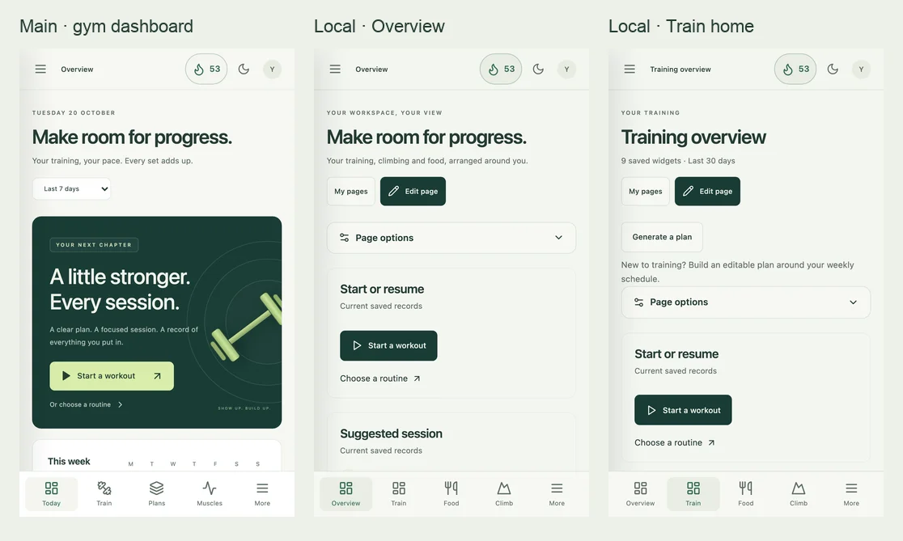
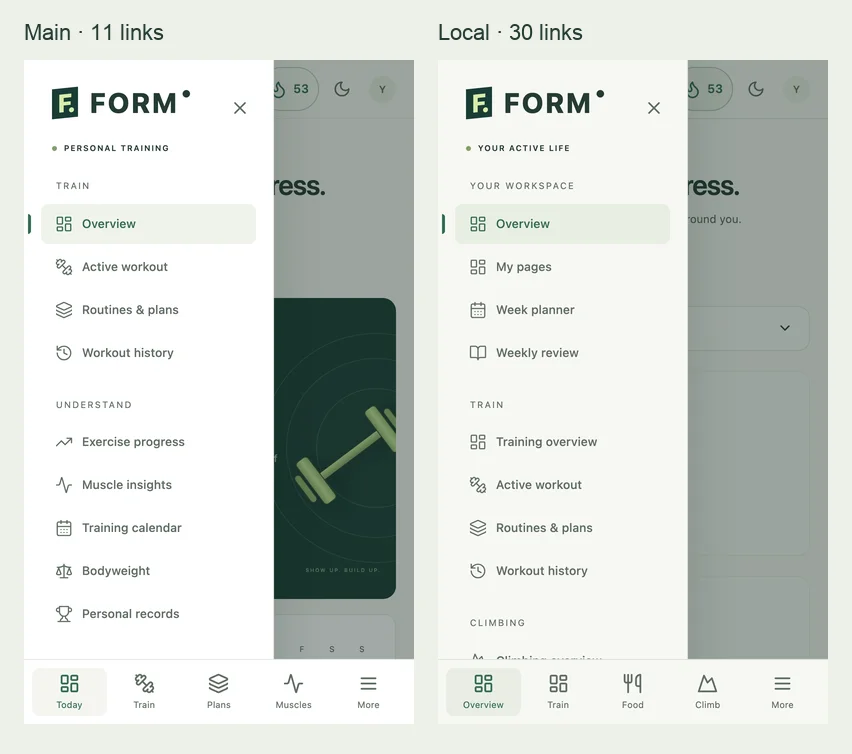
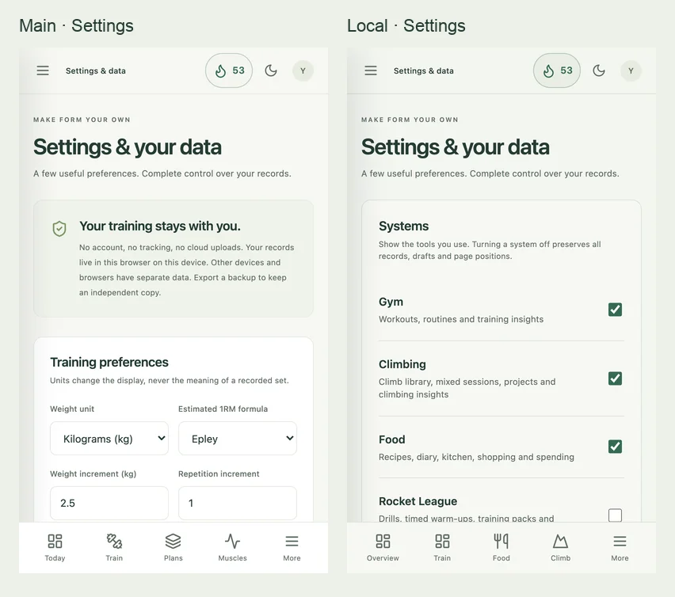

# FORM: local development versus main

Reviewed 20 October 2026. Baseline: `main` at `ed5fe0f`. Local: `codex/custom-workspace` at `f53549b`, including the two new practice systems. Everything remains local; this review does not deploy or replace anyone’s saved layout.

**The extra systems are useful, but the default interface asks people to manage too many things at once. Keep the capabilities and make the daily view simpler.** The gym app has one clear purpose, consistent actions and a small navigation menu. The local app often gives page management, setup, logging, planning and analysis equal prominence.

## What changed

There are 27 local feature/documentation commits after main, starting with the food system. Before this request, the branch already differed by 147 files, about 28,000 added lines and 800 removed lines. That includes tests and documentation; it is not a measure of user-facing complexity. With the practice systems, the source-only difference is 87 files, 23,707 additions and 786 removals.

| Area                       | Local capabilities worth keeping                                                                                                    | Where the interface grew                                                                                        |
| -------------------------- | ----------------------------------------------------------------------------------------------------------------------------------- | --------------------------------------------------------------------------------------------------------------- |
| Gym                        | Original logging and analytics, progression suggestions, previous notes, equipment setups, reviewed plan generation, pasted history | More ways to start, plan or import a session; setup prompts remain visible after history exists                 |
| Food                       | Recipes and photos, diary and macro goals, meal suggestions, planning, kitchen stock, shopping, receipt review and budgets          | Nine main links and ten default home widgets; daily food logging competes with kitchen administration           |
| Climbing                   | Mixed sessions, projects, grades, wall-style map, weekly goals and session history                                                  | Four navigation links and eight default home widgets                                                            |
| Shared workspace           | Custom pages, widget editing/removal/dragging, ranges, layout sharing, week planner and weekly review                               | Generic page controls and eleven default Overview widgets, with several overlapping ways to reach a task        |
| Personal preferences       | System switches, home selection, themes, density, text, navigation, chart and logging preferences                                   | Configuration is available but a new user must make many choices to recover a focused view                      |
| Data and setup             | Optional profile onboarding, editable goals, complete/category backups, recovery snapshots, reversible demo                         | Settings now combines identity, daily preferences, all systems, portability, demo tools and destructive actions |
| Rocket League and football | Separate drill/routine libraries, persisted work/rest runner, manual results, weekly goals, sharing and comparable progress         | Four links each when enabled; both start disabled and each gets four default home widgets                       |

## Matched phone comparison

Both builds were rendered in isolated Chromium browser contexts at **390 × 664 CSS pixels**, with the same light palette and default spacing. Main runs from an archived checkout at a separate origin. Both received identical fictional gym data: **100 workouts, 1,548 sets and 93 weigh-ins** spanning six months. Local also received 46 fictional climbing sessions and 726 food entries so its additional systems could be inspected. No personal browser database was imported into the review.

These are default pages, not a controlled timing benchmark: main defaults to seven days and the workspace to thirty. Page heights describe this fixture, not every person’s app. Native iPhone Safari, safe areas and browser chrome can change the visible viewport. The full regression suite separately exercises WebKit on a phone viewport.

| Observation                                     |     Main |    Local | Implication                                                          |
| ----------------------------------------------- | -------: | -------: | -------------------------------------------------------------------- |
| Main navigation links, standard enabled systems |       11 |       30 | Almost three times as many destinations to scan                      |
| Links if all five local systems are enabled     |        — |       38 | More systems should not expand every daily menu                      |
| Links with only Gym enabled locally             |       11 |       17 | Switches help, but workspace tools still add navigation              |
| Overview page height                            | 3,814 px | 5,058 px | Local default combines more subjects and takes more scrolling        |
| Dedicated Train home height                     |        — | 3,608 px | A system home helps, but still includes setup and editing controls   |
| Dedicated Food home height                      |        — | 4,718 px | Ten default widgets cover several different jobs                     |
| Settings page height                            | 3,418 px | 8,055 px | A long mixed form makes preferences hard to locate                   |
| Horizontal overflow in captured pages           |     None |     None | The central problem is hierarchy, rather than a broken narrow layout |

Main also has an oversized motivational banner. Restoring it would reintroduce the bloat you already asked to remove. Local’s start action sits above that old banner’s action, but **Edit page** is now the most prominent button near the top. The review should preserve the compact start widget and improve its surrounding hierarchy.

## Prioritized findings

### 1. High priority: navigation expands with every system

`src/App.tsx` lists every enabled system’s destinations, plus shared workspace, insight and management groups. On a phone, the local drawer is already scrolled past the first screen before reaching food or settings. The old drawer exposes most of its useful gym destinations at once.

**Recommended change:** keep a small system switcher; show the current system’s daily destinations inside that system. Put shared pages, planner and settings in one consistent workspace menu. Keep configurable phone shortcuts. A Gym-only preset should open Train and expose Start, Routines, History and Progress without requiring the user to hide seventeen links manually. Settings must always remain reachable.

**Acceptance:** switching to Food shows food actions; returning to Train restores training context. Turning systems off preserves data and layouts. Enabling all five systems does not add thirty-eight entries to the daily menu.

### 2. High priority: daily use competes with page editing

`src/pages/CustomPages.tsx` puts **My pages**, a primary **Edit page** button and a full-width **Page options** row before the widgets. Train also includes the plan generator and its introductory copy before its first card. A person with 100 saved workouts still sees “New to training?”. The repeated “Current saved records” captions and Explore actions add visual weight without always helping the next decision.

**Recommended change:** a small “Customize” menu opens an explicit edit mode containing page options, widget catalog, ranges, layout sharing and presentation controls. During ordinary use, lead with the useful action or today’s status. Keep setup available through an intentional setup action, and make first-use prompts dismissible. Retain keyboard movement/removal, drag handles, Undo and layout sharing.

**Acceptance:** a return visit shows the main daily action in the first phone screen. Editing is still discoverable in one step. Entering and leaving edit mode does not move or remove widgets accidentally.

### 3. High priority: the default Overview is too broad

`src/lib/workspace-model.ts` gives Overview eleven widgets; Train nine, Food ten and Climbing eight. Each has value, but a large default makes it hard to tell what deserves attention. Overview can repeat content that also exists on a system home. Further customization should help people choose, rather than make them prune a large starting page.

**Recommended change:** default Overview to three to five chosen summaries: today/next activity, a compact combined week, a food summary if enabled, and a personal focus. Keep full charts on system homes or optional analysis pages. Offer simple “Gym only”, “Training + food” and “My mix” starting layouts; all remain editable and shareable. Apply revised templates to new pages, or offer an explicit preview/reset to existing users. Preserve custom pages automatically.

**Acceptance:** a new user gets a useful compact page immediately. Adding a system offers relevant widgets without inserting them into an already customized page. Advanced users can still build a dense dashboard.

### 4. Medium priority: Settings combines too many unrelated tasks

`src/pages/Settings.tsx` renders systems, appearance, personal customization, profile, food preferences, training calculations, storage, backups, category exports, demo and reset in one document. Some customization subsections already collapse, but the overall page remains over twice the height of main in the matched fixture. System-specific settings appear even when someone is only interested in one system.

**Recommended change:** a short Settings index with sections for Systems, Appearance & layout, Profile, each enabled system, and Data & backups. Keep access to hidden-system data exports. Place demo tools and calculation assumptions in secondary sections, with Reset separate from everyday controls.

**Acceptance:** common settings can be found without scrolling through backup categories or personal measurements. Calorie visibility remains explicit opt-in. Export and recovery remain easy to find.

### 5. Medium priority: the shared header still speaks mainly to gym users

`src/App.tsx` keeps exercise search and the gym streak in the global header whenever Gym is enabled, including on food and practice pages. Training-specific footer/identity copy also remains across the workspace. These cues strengthen the original gym app but blur context in the expanded app.

**Recommended change:** use the current system’s name and a relevant primary shortcut in the header. Show the workout streak inside training or as a chosen widget. Keep shared appearance/settings access stable. Distinguish physical activity from Rocket League practice; avoid a combined fitness or recovery score.

**Acceptance:** someone opening football practice can immediately identify the current system and next action without interpreting a gym streak or exercise search button.

### 6. Medium priority: the shared loading path has grown

With the same installed dependency versions, main’s principal application chunk is **194,857 bytes** minified versus **506,876 bytes** locally. The complete PWA precache grew from **1,051.83 KiB to 1,522.00 KiB**, about 45%; optional OCR resources are excluded from those precaches. This is a build-size comparison, not a claim that phone interactions are slower.

`readData` still loads every system for the top-level live query. Food photo payloads are omitted from normal UI reads, but climbing photos and whole practice aggregates are read. With larger histories or photos this deserves measurement. The new practice UI is lazy loaded, as are climbing and settings; most food/workspace routes still share the main chunk.

**Recommended change:** measure startup and saves with realistic large histories on an actual phone; split system routes and their expensive analysis code; read the visible system’s summaries where practical. Preserve offline availability. Centralize system metadata instead of adding more route/name/dependency switches in several files. Separate practice library, runner and result views if the practice editor continues growing.

**Acceptance:** repeatable measurements before claiming a speedup; exercise logging never waits for unrelated food or practice analysis. Complete backups still read all data and attachments.

## What I would implement next

1. A compact everyday header and an explicit Customize mode.
2. A system switcher with navigation scoped to the current system, plus a Gym-only starting preset.
3. Lean Overview and system templates, offered to existing users as a reviewable choice.
4. A short Settings index, followed by targeted loading/performance measurements.

The aim is that a friend can use FORM as a clear gym tracker, another can use food and football, and you can use all systems without maintaining five dashboards before starting a session. Keep the customization tools behind a simple useful default.

## New practice systems delivered with this review

- Rocket League: `74ad873` — editable warm-up templates, freeplay/pack/playlist drills, timed or count targets, saved runner, work/rest controls, history, goals, sharing and widgets.
- Football: `f53549b` — separate library and routines, keepy-up tries/median/bests, cone diagrams, space/equipment/solo filters, left/right comparisons and intended shot target zones.
- Both start off. Enable them in Settings → Systems. No game telemetry, accounts or health integrations were added. Results are manual; timers and completed records persist locally. See [practice usage and data details](PRACTICE-SYSTEMS.md).
- Schema 6 backups include both systems; schemas 2–5 migrate. Full replacement, merge conflicts, category isolation and pre-import recovery are covered by storage tests. Existing saved pages and enabled-system preferences are retained.

## Evidence and limits

Screenshots are captured from production builds using fictional records. Full-page evidence: [main Overview](review-assets/main-today-full.webp), [local Overview](review-assets/local-today-full.webp), [main Settings](review-assets/main-settings-full.webp), [local Settings](review-assets/local-settings-full.webp). [Recorded metrics and fixture counts](review-assets/metrics.json) accompany the images.

The review combines code comparison, matched phone rendering and automated functional/accessibility checks. It is not a user study, a physiological assessment, a security audit or a native-device performance benchmark. Recommendations above remain review findings; this task has not overwritten the user’s navigation or widget arrangements.

Validation:

- Baseline before changes: 200 unit/storage tests passed.
- Final implementation: **210 unit/storage tests passed** across 21 files; TypeScript and production build passed.
- Full browser regression: **188 passed, 1 skipped** across desktop Chromium, phone Chromium and phone WebKit (189 scenarios). The skip is the existing WebKit touch-drag scenario; alternative keyboard/mouse movement remains covered.
- Three additional runs of the new Rocket League flow pass after adding explicit offline reload, recording and finishing checks (one per browser project).
- New flows include opt-in controls, goals, starter templates, saved timers, manual results, library editing and sharing, course persistence, target maps, accessibility and narrow layouts.
- The existing 4174 preview was updated through its normal PWA update controls. The user’s three enabled systems, dark theme and existing workout streak remained; new switches are off. No personal data was used for the report images.
- `pnpm exec prettier --check` and `git diff --check` are run before the review commit.
