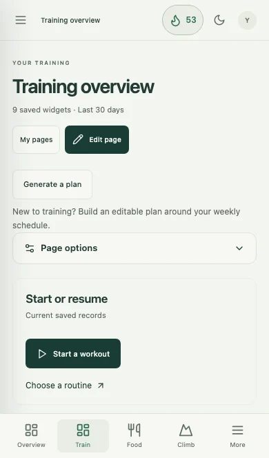

# FORM systems expansion: release readiness review

Reviewed 20 October 2026 against freshly fetched `origin/main` (`ed5fe0f`). The feature branch is `codex/custom-workspace` at `eaa0123`: **30 commits ahead, none behind**. The working tree was clean when the review began. This report describes the pre-integration review. The user subsequently approved integration into `main` with the development sample loader removed. The findings below remain recommendations; this publication does not implement them or deploy Pages.

**Recommendation: retain the systems, but finish a focused release cleanup before making this the default experience for existing users or friends.** The implementation has substantial automated coverage and careful storage safeguards. Its main weakness is that an optional, personal workspace still opens like a large multi-purpose control panel. There are also concrete backup-preview and attachment-lifecycle issues to correct.

## 1. What actually changed

The diff contains **169 files, 32,474 added lines and 829 removed lines**. Application source accounts for **88 files, 24,121 additions and 818 removals**. The remainder includes tests, documentation, review images and the local OCR engine/model. Line counts describe scope, not quality.

`main` already includes workout logging, routines/programmes, history, progression suggestions, exercise/muscle/bodyweight analytics, gym streaks, reset, offline use and gym library sharing. Those should not be presented as newly delivered by this branch.

| Area          | Added locally                                                                                                                                                                                                                                                                                                                  | Assessment                                                                                                                                                               |
| ------------- | ------------------------------------------------------------------------------------------------------------------------------------------------------------------------------------------------------------------------------------------------------------------------------------------------------------------------------ | ------------------------------------------------------------------------------------------------------------------------------------------------------------------------ |
| Gym           | Reviewed split/day plan generator; equipment setups and load conventions; previous exercise/set notes during workouts; reviewed pasted-history import with date-only records, partial reps and notes                                                                                                                           | Useful additions to the original core. Preserve its fast logging path.                                                                                                   |
| Food          | Ingredients; recipes/menu photos; nutrition and portion calculations; diary and historical snapshots; editable maintain/lose/gain macro estimates; optional calorie display; recipe suggestions; meal planner; stock, batches, expiry and waste; shopping; purchase/receipt review, on-device OCR, recorded prices and budgets | The broadest expansion. Daily eating and kitchen administration need clearer separation in the interface.                                                                |
| Climbing      | Indoor/outdoor bouldering, top rope, auto belay and lead in one system; climb/photo library; grade/venue/style snapshots; mixed sessions and attempts/results; projects and notes; weekly goal setup, plans, wall-style map and charts                                                                                         | Useful manual tracking with honest grade separation. No automatic watch/gym data connection.                                                                             |
| Rocket League | Opt-in drill/routine library; nine editable starter routines; freeplay, pack and playlist cues; count/time targets; saved work/rest runner; manual results, history, progress, weekly goals and library sharing                                                                                                                | Focused first version. Results require manual entry and timers require deliberate completion.                                                                            |
| Football      | Separate opt-in library and nine editable routines; keepy-up attempts/bests/median; passing/shooting/dribbling; course diagrams; equipment/space/partner filters; foot-specific comparisons and shot target zones                                                                                                              | Reuses the practice engine without mixing its records with Rocket League. It is a training log, not match analysis.                                                      |
| Workspace     | Shared Overview; separate system homes; custom pages; real widgets; add/remove/Undo, drag/arrow movement, sizing, filters and date ranges; sections/tabs, separate phone arrangements; layout import/export and optional appearance presets                                                                                    | Supports the goal that friends use FORM differently. Defaults currently expose too much configuration.                                                                   |
| Shared tools  | Combined week planner for enabled systems, optional weekly review, optional profile onboarding, themes, spacing/text/contrast preferences, navigation/phone shortcuts, macro/chart/logging preferences                                                                                                                         | Valuable when available on demand. They should not dominate ordinary daily use.                                                                                          |
| Streaks       | Independent Gym, Climbing, Rocket League and Football calendars, widgets and rest banks; no Food streak                                                                                                                                                                                                                        | Each uses its own completed history. Start with five rest days, earn one per additional activity day, cap at seven; protected rest does not increase activity-day count. |
| Portability   | Schema 6 complete/category backups, support for older schemas, attachment manifests, transactional recovery, private layout sharing                                                                                                                                                                                            | Good foundations. Backup UX, attachment cleanup and rollback instructions need attention before release.                                                                 |

Calories remain hidden unless explicitly enabled. Meal suggestions rank saved recipes using recorded macros, stock, time and cost; they do not invent meals or nutrition data. Generated training and food plans are editable previews which require acceptance.

Not added: accounts/cloud sync, automatic cross-device backup, Apple Health/weight import, Garmin/Griptonite connections, Rocket League telemetry, automatic football/video analysis or a social feed. Friends have independent data when using their own browser storage. Sharing templates/layouts exchanges files, not live records. People using the same browser profile share one database.

Food still depends on the user supplying reliable ingredient nutrition, package conversions and receipt corrections. OCR is a reviewed suggestion, not guaranteed supermarket receipt recognition. Shopping-list receiving and receipt receiving are separate paths: the app warns against using both for the same purchase but does not automatically reconcile them. These are practical limits for friends to understand, rather than promises of an automated nutrition or inventory service. See [Food limits](FOOD.md).

## 2. Findings, in release priority order

### R1 — High: an existing gym user is automatically moved into a mixed workspace

**Evidence:** the v4 upgrade writes `defaultWorkspace()`, whose systems enable Gym, Food and Climbing and whose home is the mixed Overview. Missing older climbing preferences also default to enabled. See [database upgrade](../src/lib/db.ts#L102), [default workspace](../src/lib/workspace-model.ts#L325) and [schema defaults](../src/lib/workspace-model.ts#L149). A targeted test using the actual archived main database class reproduced these upgrade defaults while retaining the existing routines.

**Impact:** the person who installed a clear gym tracker receives three systems and eleven Overview widgets without choosing them. Turning systems off is possible, but the user must first discover how to recover their old focus. Rocket League and Football already use the better opt-in model.

**Before release:** let new users choose systems or a starting preset. Keep existing gym users focused on Train unless they explicitly choose a broader home. Preserve everyone who has already configured this development version; do not replace their systems or pages as a migration shortcut.

**Acceptance:** an upgraded gym-only profile can open and resume a workout immediately; a new friend can choose Gym only, Training + food or a custom mix. Enabling another system does not silently rearrange a customized page.

### R2 — High: daily actions compete with page management and a growing global menu

**Evidence:** fresh production rendering at 390 × 664 CSS pixels with fictional six-month data gives **30 navigation links** with the default three systems, **38** with all five and **17** with only Gym. Main has 11 in the earlier matched fixture. The first primary button on Overview and each inspected system home is **Edit page**. Train displays My pages, Edit page, Generate a plan, introductory setup text and Page options before Start a workout. See [navigation](../src/App.tsx#L73) and [home controls](../src/pages/CustomPages.tsx#L185).

Default homes contain 11 Overview widgets, 9 Train, 10 Food, 9 Climbing and 5 for each practice system. A fresh phone capture puts Settings at 8,055 px versus main's earlier matched 3,418 px. No horizontal overflow was observed in these captures. The problem is information hierarchy and scrolling, not simply overflowing boxes.

**Before release:** add a compact system switcher and show destinations relevant to the selected system. Lead Train with start/resume, Food with logging/today's macros, and practice with start/resume. Move page controls into one Customize entry. Offer lean default dashboards, with the larger widget catalogue available in editing. Use a Settings index with separate Systems, Appearance, Profile, system-specific and Data sections.

**Acceptance:** an ordinary return visit exposes the next useful action in the first phone screen. All-five-system use does not require scanning a 38-link menu. Editing/removal, accessible movement, Undo and layout sharing remain available. Updated presets are opt-in for existing customized pages.

The new per-system header flame has already corrected part of the earlier review's global-gym-streak concern. Exercise search still appears globally whenever Gym is enabled, and some shared copy still describes only training. These are smaller consistency issues, not reasons to remove the new streaks.

### R3 — Medium, fix before release: replacement preview understates what it removes

**Evidence:** [Settings replacement warning](../src/pages/Settings.tsx#L522) names only gym and food. [Replacement execution](../src/lib/backup.ts#L325) also clears/restores practice and overwrites Climbing and the workspace. Import preview lists practice session counts but omits practice drill/routine/goal summaries. Its image count includes food files only, despite complete backups also carrying climbing photos. See [preview rows](../src/lib/backup.ts#L253) and [image count](../src/pages/Settings.tsx#L477).

**Impact:** replacing an old gym backup can remove later climbing and practice content without a useful domain-specific warning. The full-database confirmation and atomic recovery snapshot reduce risk, but the review should disclose the actual change. A file with zero practice sessions can still contain a valuable practice library which this preview does not show.

**Before release:** explicitly name all systems, workspace/profile and attachments. Show incoming and currently stored counts for each affected domain and highlight domains absent from an older file. Count both photo types. Keep category imports merge-only and retain transactional recovery.

**Acceptance:** a schema-2 file reviewed against a populated schema-6 database clearly shows that Replace will clear the newer systems; Merge remains the additive choice.

### R4 — Medium: removed/replaced menu photos accumulate and remain in complete exports

**Evidence:** [saveRecipePhoto](../src/lib/food-actions.ts#L74) inserts each new file and changes the recipe/draft reference without reclaiming the old file. An isolated reproduction uploaded A, replaced it with B and removed B. The recipe had no photo, but **both files remained in `foodFiles` and in the complete backup**. Normal recipe save likewise does not reclaim old attachments.

**Impact:** repeated edits grow storage/backups and retain images the user may believe were removed. With photos up to 5 MB, this is more consequential than a few unused metadata rows. Complete backups have a 100 MB limit; imports also need space for their recovery snapshot. Those limits are a real constraint, not a demonstrated failure with the current user's data.

**Before release:** implement reference-aware cleanup or an explicit unused-attachment manager. Check recipes, recipe steps, purchases and durable drafts before deleting a file; another record may legitimately share it. Show storage/backup size clearly. Local recovery snapshots intentionally preserve past states and need separate, explicit deletion controls, which already exist.

**Acceptance:** an unreferenced removed photo leaves the live file store/export, while images still used by another record or draft survive.

### R5 — Medium: release rollback and verification gates need an explicit procedure

**Evidence:** IndexedDB moves from v2 to v6 and complete backups from schema 2 to 6. Forward migration is additive and tested. A targeted test confirmed the old main parser rejects a new complete backup. The actual old database class could reopen a simple upgraded fixture with the installed Dexie version; it would be wrong to claim all rollbacks necessarily fail with a VersionError. That result does not establish safe old-code operation on every new-data scenario.

The [Pages workflow](../.github/workflows/pages.yml) is manual and runs unit tests/build, but does not require the independent Verify FORM workflow to have passed for the exact dispatched commit. It can publish a selected branch. This is inherited infrastructure rather than a newly introduced defect; the expanded release makes it more important.

**Before release:** keep an independent pre-upgrade hosted backup, rehearse upgrade and rollback in a separate installed-PWA profile, and document that reverting Git does not restore data or convert backups. Require or explicitly check successful CI for the exact release commit before dispatching Pages. Refresh the deployment/backup guides: they still refer to the old food branch, format 5 and older test counts in places.

**Acceptance:** preserve a populated main profile, update it, resume its active workout, save new-domain records, test offline, export/restore on the new version, and rehearse the documented fallback without clearing the live user's storage.

### R6 — Medium: hidden systems still participate in global reads and saves can copy whole histories

**Evidence:** [top-level live query](../src/App.tsx#L171) calls [readData](../src/lib/db.ts#L126), which reads every system regardless of switches. Food image bodies are excluded in normal UI reads; Climbing's embedded photos and whole practice rows are not. Every [practice mutation](../src/lib/practice-actions.ts#L13) reads, validates and writes the system aggregate, including its entire session history. Climbing also uses an aggregate. Food/workspace UI remains largely in the eager application graph, although practice, climbing and settings have lazy chunks.

The current principal app chunk is **510,320 bytes** minified versus the earlier unchanged-main artifact's 194,857 bytes with the same installed dependency versions: about 2.6×. The PWA precache is **1,531.38 KiB** versus 1,051.83 KiB, about 46% larger. Roughly 9.5 MiB of optional OCR resources are excluded from precache and fetched on demand. First-use offline OCR therefore cannot be assumed. These are size/architecture observations, not proof of slow phone interaction.

**Before broad use:** measure startup, completing a gym set, saving practice results and exporting backups on a physical phone with realistic long histories and photos. Split remaining system routes, avoid unrelated reads in the logging path and consider individual session rows before aggregate histories become large. Add a measured regression budget rather than guessing at a safe record count.

**Acceptance:** fast gym logging with large unrelated Food/Climbing data; no claim of speed improvement without repeatable measurements. Offline availability and complete exports remain intact.

### R7 — Medium validation gap: five-system interactions and real iPhone use need more evidence

The existing browser test titled “all system combinations” exercises the eight Gym/Food/Climbing combinations. The newer systems have dedicated opt-in/hide/runner tests, but the matrix is not all 32 five-system combinations. See [combination test](../e2e/workspace.spec.ts#L190). Test data can cover pairwise combinations and the important all-on/all-off/practice-only/hidden-active-session cases without blindly multiplying every browser scenario.

WebKit covers many phone flows, but the touch-drag test is skipped there because it uses Chromium's touch-injection protocol. Mouse/keyboard movement and Chromium touch pass. This does not establish native iPhone dragging. Installed-PWA upgrade behavior, camera/photo formats, virtual keyboard, suspended timers, wake lock/sound and storage pressure still need a real-device check. PNG/JPEG/WebP are supported; HEIC/PDF receipt import is not.

**Before release:** run the old-gym-to-new-app rehearsal and a short physical-iPhone acceptance pass. Expand the system-interaction checks. Keep accessible arrow movement as a real alternative to dragging.

### R8 — Lower priority: growth has outpaced some shared structure and wording

`Practice.tsx` is 1,365 lines, `Widgets.tsx` 1,172 and `CustomPages.tsx` 1,041. Food menu/shopping pages are also large. System identities and route/dependency logic appear in several modules. This makes future additions more error-prone and helps explain stale preview copy; it is not evidence that these screens are currently broken.

Extract routine editors, runner/results and widget domain implementations as they are next changed, and centralize system metadata. Avoid a broad rewrite as a prerequisite for the initial release. Explain that streaks count qualifying activity days rather than simply consecutive calendar days; weekly goals and rest-bank streaks measure different things.

## 3. What is working well

- The original gym path and its completed-set analytics remain covered by the regression suite. Suggestions and templates do not silently rewrite completed sessions.
- Forward schema changes add stores rather than rewriting/deleting the old gym tables. Actual old-version database tests retain existing records and preferences.
- Full replacement and its recovery snapshot share one transaction; failure rolls both back. Merge preserves existing identities, rejects incompatible inventory/active-session conflicts and is not advertised as synchronization.
- Disabling systems retains their records. Existing custom pages are preserved; new streak widgets upgrade only exact untouched old templates.
- Sharing distinguishes templates/layouts from complete personal backups. Layout notes and appearance are explicit options; personal records are excluded. Full backups intentionally include profile, notes and drafts and should remain private.
- Historical gym, food, climbing and practice snapshots preserve what was recorded, rather than changing when a library entry is edited.
- Calories remain opt-in, Food has no streak, incomplete data is generally shown as unknown, and practice timers do not fabricate completed results.
- No new package dependencies or lockfile/workflow changes were introduced. Hosting remains a static site; no backend account or service secret is required for these features.
- Separate local commits exist from the original Food addition onward. The latest routines and independent streaks each have their own commit. This is much more reviewable than one unstructured change.

## 4. Verification performed for this review

Tests and phone captures use isolated synthetic databases/browser contexts. The user's existing browser data was not reset, seeded or imported into a test.

| Check                                                                     | Result                                                                               |
| ------------------------------------------------------------------------- | ------------------------------------------------------------------------------------ |
| Fresh fetch and comparison with `origin/main`                             | 0 commits behind, 30 ahead                                                           |
| Complete unit/storage suite                                               | 220 passed in 22 files                                                               |
| TypeScript and root production/PWA build                                  | Passed; large app-chunk warning remains                                              |
| Full root browser suite, desktop Chromium / phone Chromium / phone WebKit | 200 passed, 1 skipped (201 scenarios, 5.0 minutes)                                   |
| Repository-subpath production build in separate output directory          | Passed; established port 4174 root build retained                                    |
| Targeted repository-subpath browser checks                                | 39 passed across the same three browser projects (1.7 minutes)                       |
| Pinned OCR assets/notices                                                 | All 9 recorded hashes and sizes match                                                |
| Two additional isolated audit checks                                      | Passed: upgrade/default/rollback-parser behavior and attachment retention reproduced |
| Fresh 390 × 664 production captures                                       | Overview, Train, Food, Climbing and Settings inspected; no horizontal overflow       |
| Format and whitespace                                                     | Repository-wide Prettier and Git whitespace checks passed                            |

Fresh [recorded measurements](review-assets/release-metrics.json) use the same fictional fixture as the earlier review: 100 workouts, 1,548 sets, 93 weigh-ins, 46 climbing sessions and 726 food entries. Overview is 5,058 px high, Train 3,608, Food 4,718 and Climbing 5,147. Main's 3,814 px Overview and 3,418 px Settings are from the earlier same-day matched baseline artifact; main has not changed. Main's seven-day default and local's thirty-day default are different, so page heights are illustrative, not an equal-content usability or timing benchmark.

The initial extra path run used an incorrect test entry URL and produced two failures. After supplying the required `TEST_SUBPATH=/form-test/`, the complete selected 39-scenario run passed. No application code was changed to obtain that result.

The [earlier phone comparison](LOCAL-VS-MAIN-REVIEW.md) remains useful visual evidence, but predates the latest routine catalogue/streak commits and its feature counts/test totals should not be used as current release results.

This focused review covers defaults, routing, daily hierarchy, storage/migration, backup/import, attachment lifecycle, shared planning/review, streaks, sharing and release mechanics. It is not an exhaustive line-by-line security audit, a screen-reader certification or a physical-device performance benchmark. Passing tests does not close the specific findings above.

## 5. Recommended path to main and publication

1. **Freeze feature scope.** Keep the five systems and workspace; postpone further systems/integrations until everyday use is clear.
2. **Make a small series of cleanup commits.** Fix backup disclosure and unused photos; introduce explicit system choice and a focused gym upgrade path; simplify navigation, primary actions and Settings. Offer layout changes to existing users instead of replacing their choices.
3. **Rehearse a real upgrade with synthetic old-version data.** Include an active workout/timer, offline cached installation, all data domains, backup restore and documented fallback. Add the missing system combinations and check a physical iPhone.
4. **Review one integration PR after the cleanup.** The commits are well separated historically, but later systems depend on the shared workspace/schema/backup work. They are not independent plugins that can all be cherry-picked in arbitrary order. A reviewable integration PR is preferable to rewriting stable local history solely to make it look smaller.
5. **Merge and publish as separate actions.** Push/merge runs verification; the current workflow requires an explicit manual Pages deployment to change the hosted app. Check successful CI for the exact commit and complete hosted smoke checks before calling the release successful.

If a smaller first release is wanted, keep the code and make systems opt-in rather than extracting intertwined commits at the last moment. Do not change the local user's already chosen systems to achieve that default.

Git publication transfers source code. It does not copy port 4174's records to GitHub Pages or sync a friend's phone. Existing hosted data upgrades in place at the same origin; deliberately transferring local records requires export/import. Keep a separate backup of hosted records before updating them.

**Current decision:** suitable for continued personal testing and a reviewed preview; complete the release cleanup and upgrade/device checks before replacing the clear public gym experience.
